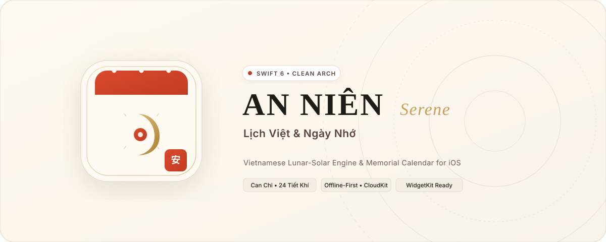
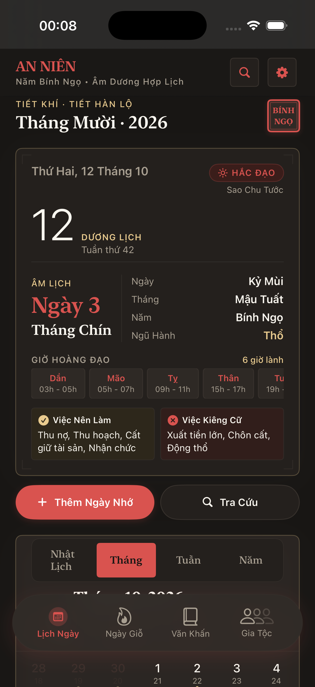

<div align="center">

# An Niên (Serene) — ベトナム旧暦＆命日・祭礼カレンダー

[ English ](README.md) · [ Tiếng Việt ](README.vi.md) · [ **日本語** ](README.ja.md)

<p align="center">
  
</p>

[](https://github.com/iletai/Serene/actions)
[](https://swift.org)
[](https://developer.apple.com/ios/)
[](https://opensource.org/licenses/Apache-2.0)

An Niên（Serene）は、SwiftUI、SwiftData、WidgetKit を用いて構築された iOS ネイティブアプリです。高精度なベトナム陰陽暦（旧暦）天文学計算と、命日（Giỗ）や伝統祭礼のリマインダー機能を融合しています。ネオミニマリズムデザイン、Apple New York タイポグラフィ、Swift 6 の厳格な並行処理（Strict Concurrency）を採用しています。

[主な機能](#-主な機能) · [アーキテクチャ](#-アーキテクチャ) · [導入とビルド](#-導入とビルド) · [ライセンス](#-ライセンス)

</div>

---

## 📱 スクリーンショット

<div align="center">
  &nbsp;&nbsp;&nbsp;&nbsp;
  &nbsp;&nbsp;&nbsp;&nbsp;
  
</div>

---

## ✨ 主な機能

- **旧暦計算エンジン (`VNCalendarLunar`)**: Jean Meeus および Ho Ngoc Duc のアルゴリズムに基づく GMT+7 基準の高精度天文学計算。外部依存なしで干支（Can Chi）、二十四節気（Tiết Khí）、黄道・黒道吉凶時（Hoàng Đạo / Hắc Đạo）、閏月を正確に算出。
- **カレンダー UI アダプター (`VNCalendarKit`)**: `iletai/SwiftUICalendarView` をラップした固定 42 セル（6x7）グリッド構造。レイアウト崩れを防ぎ、整数キー `dateKey`（`YYYYMMDD`）による $O(1)$ 高速検索を実現。
- **スマート通知エンジン**: iOS の待機中通知上限 64 件を考慮し、上位 60 件の通知とシステム予備 4 スロットを時間減衰スコアにより自動管理：
  $$\text{スコア} = \text{priority} \times \text{offsetWeight} \times \frac{1}{1 + 0.05 \times \text{daysUntil}}$$
  小の月（29日までの月）における旧暦30日の命日を29日に繰り上げる境界値処理を自動実行。
- **命日・祭礼トラッカー**: ベトナムの伝統的な命日（ngày giỗ）や祝祭日をオフラインファーストでローカル管理。microCMS と ETag キャッシュによる差分同期に対応。
- **StoreKit 2 による収益化**: 月額（`com.iletai.annien.sub.monthly`）、年額（`com.iletai.annien.sub.yearly`）、永久版（`com.iletai.annien.nonconsumable.lifetime`）のアプリ内課金を統合。無制限の命日登録、家系アーカイブ、ロック画面ウィジェットを提供。

---

## 🏛️ アーキテクチャ

XcodeGen（`project.yml`）で管理されたマルチパッケージ SPM モノレポ構造のクリーンアーキテクチャを採用しています：

```
Packages/
├── VNCalendarLunar/          # 天文計算アルゴリズム（外部依存 0）
├── VNCalendarDomain/         # ドメインエンティティ、ユースケース、リポジトリ契約
├── VNCalendarData/           # SwiftData モデル、リポジトリ実装
├── VNCalendarDesignSystem/   # ネオミニマリズムトークン、UI コンポーネント
└── VNCalendarKit/            # カレンダー UI アダプター、グリッドレイアウト
App/                          # コンポジションルート (AppContainer), 各種機能画面, StoreKit ペイウォール
Extensions/Widget/            # WidgetKit 拡張機能 (Small, Medium, Lock Screen)
Config/                       # ビルド設定 (.xcconfig) & Entitlements
```

### 依存関係ルール
- `VNCalendarLunar`: 内部・外部依存なし。
- `VNCalendarDomain`: `VNCalendarLunar` のみに依存。SwiftUI や SwiftData のインポート禁止。
- `VNCalendarData`: `VNCalendarDomain` および `VNCalendarLunar` に依存。
- `VNCalendarDesignSystem`: `VNCalendarDomain` に依存。
- `VNCalendarKit`: `VNCalendarDomain`, `VNCalendarDesignSystem`, `VNCalendarLunar`, 外部 `iletai/SwiftUICalendarView` に依存。
- `AnNien (App)`: 全ローカルパッケージおよび外部 `iletai/AppUpdateKit` をインポート。

---

## 🚀 導入とビルド

### 必要環境
- macOS 14.0+
- Xcode 15.4+ (Swift 6 コンパイラ)
- XcodeGen (`brew install xcodegen`)
- Bundler (`bundle install`)

### セットアップとビルド手順
1. リポジトリをクローン：
   ```bash
   git clone https://github.com/iletai/Serene.git
   cd Serene
   ```
2. Xcode プロジェクトを生成：
   ```bash
   xcodegen generate
   ```
3. テストを実行：
   ```bash
   bundle exec fastlane test
   ```

---

## 📄 ライセンス

Apache 2.0 ライセンスの下で配布されています。詳細は [LICENSE](LICENSE) をご覧ください。
